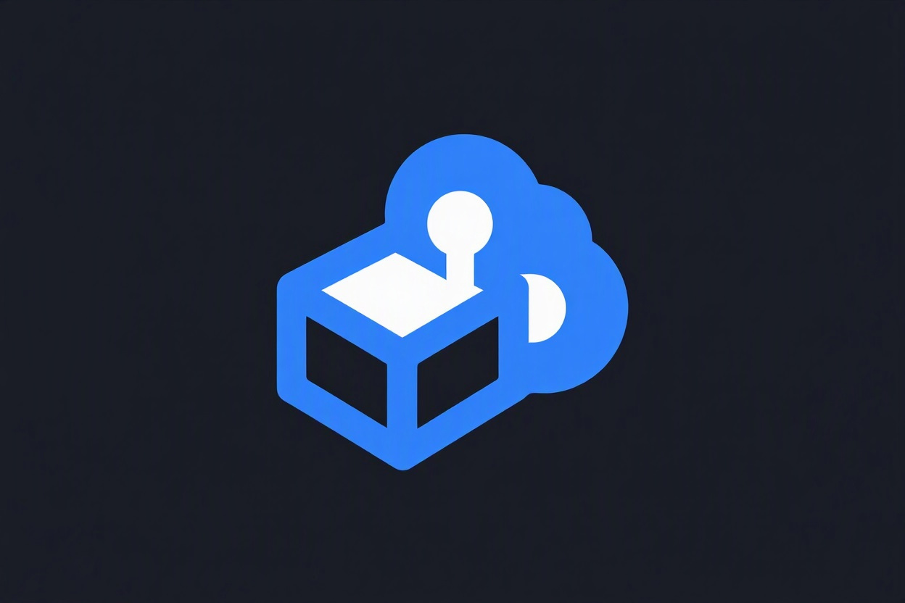

  
  <h1>HYNA-Stage: Ephemeral Cloud Sandboxes</h1>
  
<strong>Deploy an app to a live URL in 5 seconds. No Docker, no YAML, no credit cards. Built on a $150 Android phone.</strong>

  
  

---

## ⚡ The Pitch
AI agents write code in seconds, but deploying it to a safe staging environment takes minutes. 

**HYNA-Stage** is a CLI that spins up isolated Firecracker MicroVMs via E2B, deploys your HTML/code, and returns a live URL instantly. 

To save costs and prevent rogue agents from persisting, **every sandbox auto-destroys after its TTL (Time-To-Live) expires.**

## 🚀 Quick Start

Install the CLI globally:
`npm install -g @hynaweb/stage`

Authenticate (one-time):
`hyna-stage login`

Deploy a file:
`hyna-stage up index.html --ttl 120`

> **Output:**
> ✔ Sandbox is live
> 
> ID: ietpcwda0h9n1dxh1agz5
> 
> URL: https://3000-ietpcwda0h9n1dxh1agz5.e2b.app
> 
> TTL: 120s

Open the URL in your browser. Your app is live on the internet.

## 🧹 Destroying Sandboxes
You can manage your environments visually from the [Live Dashboard](https://hyna-stage.netlify.app), or destroy them via CLI:
`hyna-stage down ietpcwda0h9n1dxh1agz5`

## 🏗️ The Stack
- **CLI:** Node.js (ES Modules), Commander.js
- **Backend:** Supabase Edge Functions (Deno)
- **Database:** Supabase PostgreSQL
- **Compute:** E2B (Firecracker MicroVMs)

## 🥖 The Story
I’m 12 years old. I don't own a laptop. I built this entirely on an Android phone using Termux. 

I wanted a tool that let me go from "I wrote a file" to "I have a live URL" without dealing with AWS, Docker, or billing dashboards. HYNA-Stage is that tool.

*Read the full story of how I bypassed the Supabase API gateway to build this on [Dev.to](https://dev.to/koda2026).*

## ⭐ Support the Project
If you want an easier way to deploy sandboxes, give this repo a **Star**! It helps a 12-year-old founder more than you know.

---
*Copyright (c) 2026 Harun (HYNAWEB). All Rights Reserved.*
